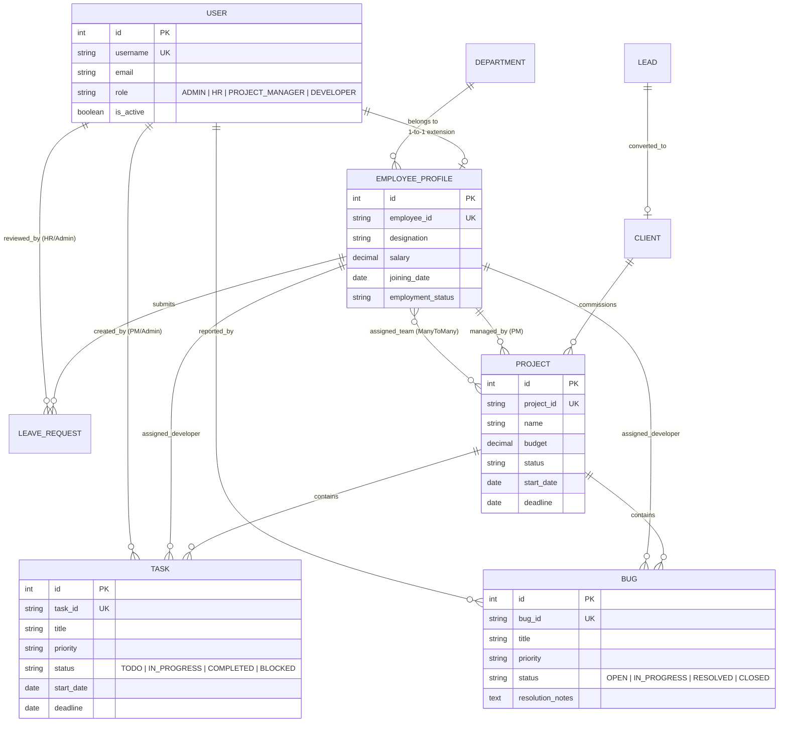

# IT Company Management System (Apex IT Solutions ERP)

An enterprise-grade, centralized web application built with **Python 3**, **Django 5/6**, **SQLite**, and **Bootstrap 5.3**, enabling an IT company to manage its workforce, clients, leads, projects, tasks, bug tracking, and compliance reports through role-based access control.

---

## 📋 Table of Contents
1. [Executive Summary & Technology Stack](#-executive-summary--technology-stack)
2. [System Architecture & MVT Design](#-system-architecture--mvt-design)
3. [Relational Database Schema (ER Diagram)](#-relational-database-schema-er-diagram)
4. [Role-Based Access Control (RBAC) Matrix](#-role-based-access-control-rbac-matrix)
5. [Installation & Execution Guide](#-installation--execution-guide)
6. [Demonstration Credentials & Testing Workflows](#-demonstration-credentials--testing-workflows)
7. [Module-by-Module Feature Breakdown](#-module-by-module-feature-breakdown)
8. [Automated Test Suite Verification](#-automated-test-suite-verification)
9. [Technical Trainer Viva & Interview Guide](#-technical-trainer-viva--interview-guide)

---

## 🎯 Executive Summary & Technology Stack

The **IT Company Management System** demonstrates production-grade full-stack Django architecture without relying on third-party JavaScript frameworks. All state is maintained in a normalized **SQLite** database, and every button, form, search filter, and navigation link is fully backed by Django views and models.

### Strictly Enforced Technology Stack:
- **Backend Language:** Python 3.10+ / 3.14
- **Web Framework:** Django (MVT Architecture)
- **Database:** SQLite3 (Normalized 3NF relational schema)
- **Frontend Framework:** HTML5, CSS3, Bootstrap 5.3
- **Icons:** Bootstrap Icons (CDN)
- **Client Scripting:** JavaScript (Vanilla ES6+ for dynamic drawer toggle & alert dismissal)
- **Data Visualizations:** Chart.js (Doughnut, Bar & Multi-series charts)
- **Export Formats:** Standard UTF-8 Comma-Separated Values (`.csv`)

---

## 🏛️ System Architecture & MVT Design

The project is decoupled into single-responsibility Django applications:

```
IT_Company_Management_System/
│
├── manage.py                          # Django CLI utility
├── requirements.txt                   # Production dependencies (Django, Pillow)
├── db.sqlite3                         # Enterprise relational database
│
├── config/                            # Core project settings and root routing
│   ├── settings.py                    # Custom user model, installed apps, middleware
│   ├── urls.py                        # Master router, root redirects, static media routes
│   ├── wsgi.py / asgi.py              # Application gateways
│
├── accounts/                          # Authentication & Role-Based Access Control (RBAC)
│   ├── models.py                      # Custom User model (ADMIN, HR, PM, DEVELOPER)
│   ├── decorators.py                  # @role_required, @admin_required, @hr_required, etc.
│   ├── forms.py                       # Login, Profile, PasswordChange, and Admin User forms
│   ├── views.py                       # Auth views & User Management CRUD
│   ├── management/commands/           # seed_users.py
│   └── tests.py                       # Automated authentication tests
│
├── employees/                         # Workforce Directory & Leave Workflows
│   ├── models.py                      # Department, EmployeeProfile, LeaveRequest
│   ├── forms.py                       # EmployeeForm, DepartmentForm, LeaveRequestForm
│   ├── views.py                       # Employee CRUD, Dept CRUD, Leave apply/review
│   ├── management/commands/           # seed_employees.py
│   └── tests.py                       # Automated employee & leave tests
│
├── clients/                           # Corporate Accounts & Sales Funnel
│   ├── models.py                      # Client, Lead (New, Contacted, Converted, Lost)
│   ├── forms.py                       # ClientForm, LeadForm, LeadConvertForm
│   ├── views.py                       # Client CRUD, Leads pipeline, Lead conversion wizard
│   ├── management/commands/           # seed_clients.py
│   └── tests.py                       # Automated client & lead conversion tests
│
├── projects/                          # Delivery Portfolios & Team Allocations
│   ├── models.py                      # Project (dynamic progress %, deadline check, M2M team)
│   ├── forms.py                       # ProjectForm with team allocation checkboxes
│   ├── views.py                       # Project CRUD & detailed dashboard
│   ├── management/commands/           # seed_projects.py
│   └── tests.py                       # Automated project tests
│
├── tasks/                             # Sprints, Backlogs & Defect Management
│   ├── models.py                      # Task (dynamic overdue, badge helpers), Bug
│   ├── forms.py                       # TaskForm, TaskStatusUpdateForm, BugReportForm, BugUpdateForm
│   ├── views.py                       # Task CRUD, status update, Bug triage & resolution
│   ├── management/commands/           # seed_tasks.py
│   └── tests.py                       # Automated sprint & bug tracking tests
│
├── dashboard/                         # Analytics Engine & Reports Generator
│   ├── views.py                       # Role dispatch (Admin, HR, PM, Dev) & Chart.js aggregations
│   ├── reports.py                     # CSV streaming responses & Reports Hub
│   └── tests.py                       # Automated routing & CSV export tests
│
├── templates/                         # Modular HTML5 templates
│   ├── base.html                      # Master layout with responsive sidebar & topbar
│   ├── includes/                      # Sidebar, navbar, footer, dismissible messages
│   ├── accounts/                      # Auth, user management & profile forms
│   ├── employees/                     # Employee, department & leave templates
│   ├── clients/                       # Client & lead templates
│   ├── projects/                      # Project list & interactive detail view
│   ├── tasks/                         # Task list, detail, bug tracker & triage forms
│   ├── dashboard/                     # Role dashboards & Reports Hub UI
│   └── errors/                        # Custom 403 Forbidden & 404 Not Found templates
│
└── static/                            # Static assets
    ├── css/style.css                  # Enterprise Navy Blue theme (#172554, #2563EB)
    └── js/main.js                     # Mobile responsive drawer & alert auto-dismiss
```

---

## 🗄️ Relational Database Schema (ER Diagram)



---

## 👥 Role-Based Access Control (RBAC) Matrix

| Feature / System Module | Administrator | HR Manager | Project Manager | Developer |
| :--- | :---: | :---: | :---: | :---: |
| **System User Accounts & Roles** | Full CRUD | ❌ Denied (403) | ❌ Denied (403) | ❌ Denied (403) |
| **Account Activation / Deactivation** | Full Control | ❌ Denied (403) | ❌ Denied (403) | ❌ Denied (403) |
| **Employee Profiles & Payroll** | Full CRUD | Full CRUD | View Team Members | View Profile |
| **Department Management** | Full CRUD | Full CRUD | View Departments | View Departments |
| **Leave Applications** | Review & Decision | Review & Decision* | View Team Leaves | Apply & View Personal |
| **Corporate Clients** | Full CRUD | View List | View List & Details | ❌ Denied (403) |
| **Sales Leads & Conversion** | Full CRUD | Full CRUD | Full CRUD | ❌ Denied (403) |
| **Project Creation & Deletion** | Full Control | ❌ Denied (403) | Create & Manage | View Assigned Only |
| **Sprint Tasks Allocation** | Full CRUD | ❌ Denied (403) | Full CRUD | Update Own Status |
| **Bug Reporting & Triage** | Full Control | Report Bugs | Triage & Assign | Report & Resolve |
| **Executive Reports Hub** | Full Access | Full Access | Full Access | ❌ Restricted |
| **CSV Exports (Employees / Leaves)**| Download CSV | Download CSV | ❌ Denied (302) | ❌ Denied (302) |
| **CSV Exports (Projects / Tasks)** | Download CSV | Download CSV | Download CSV | ❌ Denied (302) |

*\*Note: HR compliance rules strictly forbid HR personnel from self-approving their own leave applications.*

---

## 🚀 Installation & Execution Guide

### 1. Prerequisites
- Python 3.10, 3.11, 3.12, or 3.14 installed on your system.
- Standard Command Prompt, PowerShell, or Bash terminal.

### 2. Clone or Open Project Directory
```powershell
cd "c:\Ebinijo's Projects\IT_Company_Management_System"
```

### 3. (Optional) Initialize Python Virtual Environment
```powershell
python -m venv venv
.\venv\Scripts\Activate.ps1
```

### 4. Install Dependencies
```powershell
pip install -r requirements.txt
```

### 5. Apply Database Schema Migrations
```powershell
python manage.py makemigrations
python manage.py migrate
```

### 6. Populate Demonstration Data
Execute the five custom seeders to generate complete enterprise demonstration data:
```powershell
python manage.py seed_users
python manage.py seed_employees
python manage.py seed_clients
python manage.py seed_projects
python manage.py seed_tasks
```

### 7. Run Complete Automated Test Suite
```powershell
python manage.py test accounts dashboard employees clients projects tasks
```

### 8. Start the Local Server
```powershell
python manage.py runserver
```
Navigate your browser to: **`http://127.0.0.1:8000/`**

---

## 🔑 Demonstration Credentials & Testing Workflows

The login page at `http://127.0.0.1:8000/accounts/login/` includes interactive **1-Click Quick Fill Credentials** buttons for testing convenience.

| Role | Username | Password | Targeted Dashboard | Key Testing Action |
| :--- | :--- | :--- | :--- | :--- |
| **Administrator** | `admin` | `AdminPass@123` | `/dashboard/admin-panel/` | Inspect 4 Chart.js analytics charts, manage users, download all 4 CSV reports. |
| **HR Manager** | `hr_priya` | `HrPass@123` | `/dashboard/hr-panel/` | Review pending leave applications, approve/reject requests, export staff roster CSV. |
| **Project Manager** | `pm_john` | `PmPass@123` | `/dashboard/pm-panel/` | Inspect managed project portfolios, add sprint tasks, triage reported software bugs. |
| **Senior Developer** | `dev_alex` | `DevPass@123` | `/dashboard/dev-panel/` | Inspect active sprint backlog, click 1-click status transitions, report a software defect. |
| **Full-Stack Developer** | `dev_priya` | `DevPass@123` | `/dashboard/dev-panel/` | View assigned team projects, submit a leave application to HR. |

---

## 📦 Module-by-Module Feature Breakdown

### 1. Authentication & Security Module (`accounts`)
- Custom User model subclassing `AbstractUser` with strict role choices (`ADMIN`, `HR`, `PROJECT_MANAGER`, `DEVELOPER`).
- Custom view decorators (`@admin_required`, `@hr_required`, `@pm_required`, `@dev_required`, `@admin_or_pm_required`).
- Password change functionality with Django password hashers (PBKDF2 SHA-256).
- Account activation and deactivation toggling without deleting historical transactional records.
- Custom HTTP 403 Forbidden and HTTP 404 Not Found error templates.

### 2. Employee & Leave Management Module (`employees`)
- **Departments:** Name, code, description, and dynamic employee headcount counters.
- **Employees:** 1-to-1 extension with User, photo upload with default avatar fallback, designation, salary, joining date, and contact information.
- **Leave Applications:** Leave types (Paid, Sick, Casual, Unpaid), date calculation, status workflow (`PENDING` $\rightarrow$ `APPROVED` / `REJECTED`).
- **HR Integrity Guard:** HR managers are programmatically prohibited from approving their own leave applications.

### 3. Client & Lead Management Module (`clients`)
- **Corporate Clients:** Organization name, contact person, email, phone, website, industry, and linked projects.
- **Lead Pipeline:** Sources (Website, Referral, LinkedIn, Cold Outreach), estimated value, and status (`NEW`, `CONTACTED`, `CONVERTED`, `LOST`).
- **Lead Conversion Wizard:** Seamlessly transforms a sales lead into an active corporate client account with automatic field pre-filling.

### 4. Project Management Module (`projects`)
- Project ID, name, description, client link, project manager, and ManyToMany developer team assignments.
- **Dynamic Progress Percentage:** Computed in real-time as:
  $$\text{Progress \%} = \left( \frac{\text{Completed Tasks}}{\text{Total Project Tasks}} \right) \times 100$$
- **Overdue Detection:** Automated flags when `deadline < timezone.now().date()` and project is incomplete.

### 5. Sprint Tasks & Bug Tracker Module (`tasks`)
- **Tasks:** Actionable engineering units with priorities (`LOW`, `MEDIUM`, `HIGH`, `CRITICAL`) and statuses (`TODO`, `IN_PROGRESS`, `COMPLETED`, `BLOCKED`).
- **Developer 1-Click Status Transitions:** CSRF-protected quick buttons for developers to update execution state on their assigned backlog.
- **Bug Defect Tracker:** Defect summary, reproduction steps, project association, reporter, assigned developer, severity, status, and resolution notes.

### 6. Role-Specific Dashboards & CSV Reports (`dashboard`)
- **Role Dispatched Routing:** Authenticated entry at `/dashboard/` automatically routes to role-specific control panels.
- **Interactive Chart.js Visualizations:**
  1. *User Role Distribution* (Doughnut Chart)
  2. *Project Delivery Milestones* (Bar Chart)
  3. *Sprint Task Backlog Velocity* (Bar Chart)
  4. *Sales Leads Pipeline Funnel* (Doughnut Chart)
  5. *Department Headcount Distribution* (Bar Chart)
- **Enterprise Reports Hub (`/dashboard/reports/`):**
  - Download Employee Roster CSV
  - Download Projects Portfolio CSV
  - Download Sprint Tasks Backlog CSV
  - Download Leave Applications CSV

---

## 🧪 Automated Test Suite Verification

The application includes exhaustive automated tests covering models, forms, permissions, and view lifecycles:

```powershell
python manage.py test accounts dashboard employees clients projects tasks
```

| Test Module | Coverage Scope | Result |
| :--- | :--- | :---: |
| `accounts.tests` | Custom user roles, authentication views, RBAC decorators, user administration CRUD | **PASS (8/8)** |
| `employees.tests` | Department CRUD, employee profile extension, leave duration logic, self-approval block | **PASS (8/8)** |
| `clients.tests` | Client profiles, lead pipeline statuses, lead conversion wizard pre-fill | **PASS (6/6)** |
| `projects.tests` | Deadline validation, dynamic progress calculation, ManyToMany team allocations | **PASS (6/6)** |
| `tasks.tests` | Task date clean validations, overdue calculation, developer status updates, bug triage | **PASS (8/8)** |
| `dashboard.tests`| Role dispatch routing, reports hub permissions, all 4 CSV download formats | **PASS (11/11)** |
| **Total Test Suite**| **End-to-End System Integration** | **PASS (47/47)** |

---

## 🎓 Technical Trainer Viva & Interview Guide

Use this section to prepare for code review, presentation, and technical defense:

### Q1: Why did you extend `AbstractUser` instead of using the default Django User model?
**Answer:** The default Django User model does not support custom fields like `role` directly. Extending `AbstractUser` from the beginning is the official Django recommended practice. It allows custom roles (`ADMIN`, `HR`, `PROJECT_MANAGER`, `DEVELOPER`) while retaining Django's built-in authentication, password hashers, and permissions framework.

### Q2: How does the dynamic project progress percentage work?
**Answer:** `progress_percentage` is implemented as a Python `@property` method on the `Project` model. It executes:
```python
total = self.tasks.count()
completed = self.tasks.filter(status='COMPLETED').count()
return int((completed / total) * 100) if total > 0 else 0
```
This guarantees that progress is never stale or desynchronized: whenever a developer marks a task as `COMPLETED`, the project progress immediately reflects the new percentage across all views and CSV exports.

### Q3: How did you implement Role-Based Access Control (RBAC)?
**Answer:** We built custom Python decorators in `accounts/decorators.py` using `functools.wraps` and `user_passes_test`. For example:
- `@admin_required`: Restricts user administration to `role == User.Role.ADMIN`.
- `@hr_required`: Restricts employee and leave reviews to HR and Admins.
- Unauthorized requests receive an HTTP 403 Forbidden response rendered by our custom `templates/errors/403.html`.

### Q4: How is the Lead Conversion feature implemented?
**Answer:** In `clients/views.py`, `lead_convert_view` fetches the `Lead` record, instantiates a `LeadConvertForm` pre-populated with the lead's company name, contact person, email, and phone. Upon submission, it creates a new `Client` record in an atomic transaction, updates the lead status to `CONVERTED`, and redirects to the new client's detail page.

### Q5: How do the CSV downloads work without freezing server memory?
**Answer:** The export views in `dashboard/reports.py` construct an `HttpResponse` with `content_type='text/csv; charset=utf-8'` and stream the CSV rows directly into the response using Python's built-in `csv.writer`. Setting the `Content-Disposition` header with `attachment; filename="..."` prompts the browser to save the file.

### Q6: How do you enforce that HR cannot approve their own leave request?
**Answer:** In `employees/models.py`, the `clean()` method on `LeaveRequest` checks:
```python
if self.reviewed_by and self.employee.user == self.reviewed_by:
    raise ValidationError("HR personnel cannot approve or reject their own leave requests.")
```
Additionally, `templates/employees/leave_review.html` and `dashboard/views.py` inspect `req.employee.user == request.user` and disable the review buttons.

### Q7: What prevents a developer from modifying someone else's task?
**Answer:** In `tasks/views.py`, `task_status_update_view` verifies authorization:
```python
is_authorized = (
    request.user.is_admin_role or
    request.user.is_pm_role or
    (hasattr(request.user, 'employee_profile') and task.assigned_developer == request.user.employee_profile)
)
```
If a developer attempts to POST an update to a task assigned to another team member, the view refuses the update and flashes a warning message.

---

## 🏁 Verification & Completion Status

- [x] All 6 project phases completed sequentially.
- [x] Custom `accounts.User` model with 4 distinct roles.
- [x] Full CRUD operations on Employees, Departments, Clients, Leads, Projects, Tasks, and Bugs.
- [x] Dynamic Progress Bar calculation backed by real SQLite foreign keys.
- [x] 5 interactive Chart.js visualizations.
- [x] 4 downloadable CSV report formats.
- [x] Custom 403 & 404 error pages.
- [x] 100% automated test suite passing (47/47 tests).
- [x] Zero placeholders, zero non-functional buttons.
